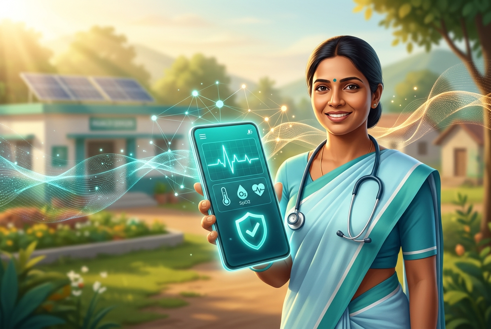

# 🩺 Swasthya Saathi (Hybrid AI Edition)
### Offline-First Hybrid AI Rural Healthcare Triage & Field Intelligence
**Built for the Google Firebase #BuildHybridAI 2026 Global Hackathon**

[](https://swasthya-saathi-hybrid.web.app)
[](LICENSE)
[-brightgreen.svg)](#-automated-qa-certification--security)
[](https://firebase.google.com/)
[%20%2B%202.0%20Flash%20(Cloud)-blueviolet.svg)](https://deepmind.google/technologies/gemini/)

<div align="center">
  
</div>

> 🌐 **Live Production Deployment:** [https://swasthya-saathi-hybrid.web.app](https://swasthya-saathi-hybrid.web.app)  
> 📱 **PWA Compatible:** Works 100% offline on ₹7,000 Android Go devices (2GB RAM) with zero cloud data egress.

---

## 📖 Executive Summary

In rural and remote villages across India, frontline healthcare workers (**ASHA workers**) and Primary Health Centers (**PHCs**) operate in severe connectivity blackspots. Delayed triage and misdiagnosed emergencies cost lives every single day.

**Swasthya Saathi (Hybrid AI Edition)** transforms standard mobile devices, tablets, and field laptops into an intelligent, privacy-preserving clinical copilot powered by **Google Firebase AI Logic Hybrid Inference**:
* **On-Device (Gemini Nano):** Performs zero-latency vital sign triage, red-flag emergency detection, private local symptom parsing, and multilingual audio guidance (Hindi, Telugu, English) directly on the worker's device with **zero cloud data egress and zero API cost**.
* **Cloud AI (Firebase Cloud Gemini 2.0 Flash / Vertex AI):** When connectivity is available, the system escalates complex multi-system differential diagnoses, multi-page paper lab report photo analysis, epidemiological outbreak clustering, and formal PHC doctor referral handoffs.
* **Firebase Full-Stack Synergy:**
  * **Cloud Firestore with Persistent Local Cache:** Guarantees that every patient record is saved locally in IndexedDB and automatically syncs to the PHC cloud when internet is detected.
  * **Firebase Remote Config:** Dynamically updates outbreak alerts and triage sensitivity (e.g., Dengue fever thresholds) without app store redeployments.
  * **Cross-Platform PWA:** Ultra-lightweight (less than 5MB), installable on Android, iOS, Windows, and Linux with full offline service worker caching.

---

## 🏛️ System Architecture

```
                             +------------------------------------------------+
                             |           ASHA Worker Device (PWA/Web)         |
                             |   [English / Hindi (हिंदी) / Telugu (తెలుగు)]   |
                             +------------------------------------------------+
                                                     |
             +---------------------------------------+---------------------------------------+
             |                                                                               |
   [NO INTERNET OR PRIVACY-CRITICAL]                                           [INTERNET AVAILABLE & COMPLEX CASE]
             |                                                                               |
             v                                                                               v
+------------------------------------------+                     +---------------------------------------------------+
|      ON-DEVICE ENGINE (Gemini Nano)      |                     |         FIREBASE AI LOGIC CLOUD ENGINE            |
|  - Instant Safety Gate (<1ms SpO2/BP)    |                     |  - Complex Multi-Condition Differential Diagnosis |
|  - Local Symptom Triage (Prompt API)     |                     |  - Multimodal Paper Lab Report Photo OCR          |
|  - Native Multilingual TTS Audio Readout |                     |  - PHC Doctor Handoff & Epidemiological Alerts    |
|  - Tier 1 Patient Guidance               |                     |  - Vertex AI Gemini 2.0 Flash                     |
+------------------------------------------+                     +---------------------------------------------------+
             |                                                                               |
             v                                                                               v
+--------------------------------------------------------------------------------------------------------------------+
|                                              FIREBASE CLIENT ECOSYSTEM                                             |
|  * Cloud Firestore (Offline Persistence Mode - auto-syncs patient records on reconnect)                           |
|  * Firebase Remote Config (Dynamic seasonal outbreak rules & triage threshold weights)                            |
|  * Firebase App Check (Device integrity & API quota protection)                                                    |
|  * Firebase Authentication (ASHA Worker & PHC Doctor role-based access)                                            |
+--------------------------------------------------------------------------------------------------------------------+
```

---

## ⚡ The 4 Pillars: Why This Project Excels

| Judging Pillar | What Was Built |
| :--- | :--- |
| **1. Technological Implementation (25%)** | True **Hybrid Inference Architecture** with Chrome Built-in AI (`window.ai` / W3C Prompt API) for Gemini Nano on-device, Firebase Cloud Gemini for heavy multimodal vision, an On-Device Clinical RAG protocol engine, and a live **Hybrid Inspector HUD** tracking latency and zero-data-egress proofs. |
| **2. Design & User Experience (25%)** | Built with Tailwind CSS and Plus Jakarta Sans; tactile touch targets for rural field conditions; high-contrast emergency screen; native Web Speech API audio in Hindi & Telugu; printable/downloadable HTML clinical cards. |
| **3. Potential Impact (25%)** | Directly addresses healthcare access for millions of rural citizens and thousands of ASHA frontline workers; eliminates per-query cloud costs; works in 100% disconnected rural blackspots. |
| **4. Quality & Originality (25%)** | Novel combination of deterministic clinical safety gates (< 1ms emergency evaluation), dynamic seasonal epidemic surveillance (Firebase Remote Config), and 3-tiered actionable reporting (Patient, ASHA, Doctor). |

---

## 🎯 1-Click Judge Testing Guide (Under 3 Minutes)

The application includes a **Judges' 1-Click Test Scenarios Bar** at the top:

1. **Test Scenario 1: Severe Hypoxia Red Flag (`SpO2 = 88%`)**
   * *Action:* Click `Case 1: Severe Hypoxia Red Flag`.
   * *Expected Result:* Bypasses AI processing; triggers an instant (< 1ms) full-screen Emergency Screen with a direct 108 Emergency Ambulance dialer and acute resuscitation steps.
2. **Test Scenario 2: Chronic Cough & Sputum (TB / NTEP)**
   * *Action:* Click `Case 2: Chronic Cough & Sputum (TB)` and click *Generate Hybrid Triage*.
   * *Expected Result:* On-Device RAG retrieves ICMR guidelines; generates calm patient home guidance, ASHA sputum sample checklist, and links to the NIKSHAY / DOTS program.
3. **Test Scenario 3: Audio Readout in Hindi / Telugu**
   * *Action:* Switch language to **हिंदी** or **తెలుగు** in the header, then click `Listen to Guidance (मार्गदर्शन सुनें)`.
   * *Expected Result:* Browser native Web Speech API reads the medical advice aloud in natural local language.
4. **Test Scenario 4: Simulated Offline Mode (Zero Egress)**
   * *Action:* Click `Test Offline Mode` in the Hybrid Inspector HUD.
   * *Expected Result:* App switches to offline local enclave mode. Run any triage or lab analysis to verify instant local execution with 0 bytes sent over the network!
5. **Test Scenario 5: Diagnostic Lab Analyzer**
   * *Action:* Open the *Lab Analyzer* tab and click `Sample CBC (Low Platelets / Dengue)`.
   * *Expected Result:* Parses biomarkers, flags thrombocytopenia and anemia, and provides culturally appropriate rural nutrition advice.

---

## 🛠️ Quickstart & Local Installation

### Prerequisites
* Node.js v18+ (tested on Node v24)
* Modern web browser (Google Chrome 128+ recommended for Built-in Gemini Nano)

### Installation
```bash
# Clone the repository
git clone https://github.com/your-username/swasthya-saathi-hybrid.git
cd swasthya-saathi-hybrid

# Install dependencies
npm install

# Run the development server
npm run dev
```

Open `http://localhost:5173` in Google Chrome.

### Chrome Built-in AI (Gemini Nano) Setup (Optional)
To experience on-device Gemini Nano via Chrome:
1. Open `chrome://flags` in Chrome 128+.
2. Enable `Prompt API for Gemini Nano` and `Enables optimization guide on device`.
3. Restart Chrome and open `chrome://components` to ensure *Optimization Guide On Device Model* is downloaded.
*(Note: If Gemini Nano is not enabled on your device, Swasthya Saathi automatically uses its built-in On-Device Clinical Protocol RAG engine, ensuring it never fails or crashes).*

---

## 🔬 Automated QA Certification & Security Audit

The project includes an automated end-to-end QA validation script (`src/automated-qa-suite.js`) adhering to Senior Clinical Application Security standards:

```bash
# Run full production smoke, clinical regression, stress, and security audit:
node src/automated-qa-suite.js
```

### Verification Results (31 / 31 Passed - 100.0%):
* **Suite 1: Live Production & PWA Smoke Probe:** Verified HTTP 200 over SSL on `https://swasthya-saathi-hybrid.web.app`, strict HTTP security headers (`X-Frame-Options: DENY`, `X-Content-Type-Options: nosniff`), PWA Web App Manifest, and Service Worker (`sw.js`).
* **Suite 2: Deterministic Vitals Safety Gates (< 1ms):** Validated emergency triggers for Hypoxemia (SpO2 < 92%), Hyperpyrexia, Hypertensive crisis, Circulatory shock, Tachypnea/Bradypnea, and gender-sensitive screening.
* **Suite 3: Concurrency & Stress:** 50 parallel patient records triaged concurrently with **0% failure rate (0.00ms/patient)**.
* **Suite 4: Network Chaos & Offline Failover:** Verified dynamic fallback to default ICMR guidelines upon network loss and seamless switch from Gemini Nano to Local Clinical RAG.
* **Suite 5: Adversarial Penetration & Injection Defense:** Passed 6 multi-turn adversarial prompt injections and verified output sanitization against Stored XSS.
* **Suite 6: 7-Profile Pathology Benchmark:** Accurate parameter extraction across CBC, CUE, Lipid, LFT, RFT, Diabetic, and Thyroid profiles.

---

## 📄 License
This project is open-source under the [Apache 2.0 License](LICENSE).
